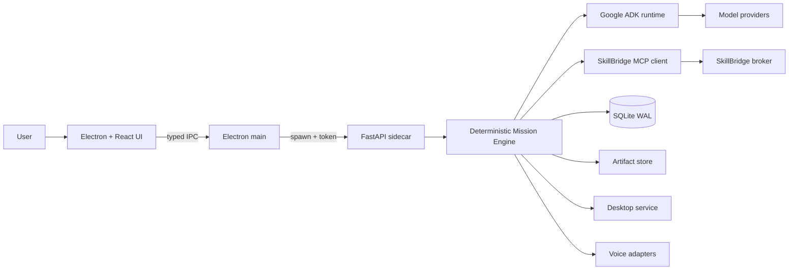

# AgentCity

**The AI operating system for your PC.** AgentCity is a Windows-first,
local-first desktop command center for Google ADK agent teams, SkillBridge
skills, supervised computer use, voice, and coding-agent handoffs.

> **Current status: M0 — architecture and context foundation.**
> The documentation, rules, diagrams, and tool pins exist. The application has
> not been built yet. Every feature in the product docs is marked `planned`
> until it has implementation, tests, and evidence. Nothing here claims a
> working UI today.

## Why AgentCity

Most "agent dashboards" animate fiction. AgentCity is designed around the
opposite rule: every agent, mission, tool call, approval, cost, and artifact on
screen must be backed by a persisted runtime event. The command map is a view of
real state, not a screensaver.

AgentCity is not a fork or rebrand. It integrates proven tools instead of
reimplementing them:

- **Google ADK 2.12** — agent reasoning, teams, workflows, evaluation.
- **ADK Agent Builder** — build-time generation and validation of agent code.
- **SkillBridge** — runtime MCP broker for skill discovery, verification,
  loading, and invocation.
- **Electron + React + TypeScript** — secure desktop shell.
- **Python + FastAPI + SQLite** — local mission runtime and durable state.

## Architecture at a glance



Full diagrams and boundaries: [`docs/architecture/overview.md`](docs/architecture/overview.md).

## Quick start (M0)

For the M0 documentation pack you need Windows 11, Python 3.12+, Git, and
PowerShell 5.1+. Node 24+ and `uv` are needed from M1. A provider key is optional
even then: Offline Mode is the default. No `.env` is required for M0. Run all
commands from the repository root.

```powershell
# 1. Verify the pinned tool clones. This does not modify them.
powershell -File scripts/bootstrap-skills.ps1 -VerifyOnly

# Fresh machine only: restore from sources you supply. This repository does not
# record repository URLs. Use the upstream URLs or local checkouts you obtained
# the tools from. If you already have checkouts elsewhere, inspect their remotes:
#   git -C <existing-adk-checkout> remote -v
#   git -C <existing-skills-checkout> remote -v
# powershell -File scripts/bootstrap-skills.ps1 `
#   -AdkRepoUrl "<adk-agent-builder-url>" `
#   -SkillsRepoUrl "<skills-bridge-url>"
# ...or copy from local checkouts:
# powershell -File scripts/bootstrap-skills.ps1 `
#   -AdkFromLocal "C:\src\adk-agent-builder" `
#   -SkillsFromLocal "C:\src\skills-bridge"

# 2. Verify the local toolchain
python -c "import google.adk; print('google-adk ok')"
$env:PYTHONPATH='src/skills/skills-bridge/src'; python -m skillbridge --version

# 3. Validate the documentation pack
python scripts/check-docs.py

# 4. Read the context pack before contributing
Get-Content docs\AI_CONTEXT.md
```

If PowerShell blocks the script with an `ExecutionPolicy` error, rerun that one
command with `-ExecutionPolicy Bypass` after reviewing the script. Do not change
the machine-wide policy just for setup.

`scripts/generate-context.py` is not a check. It rewrites
`docs/agentcity/state-of-build.md` and `docs/repo-map.md` from the manifest. Run
it only when you intend to update those files, and commit the result.

The application launch command will be added here when the M1 vertical slice
lands. There is intentionally no `npm run dev` yet.

## Repository layout

| Path | Purpose |
|---|---|
| `src/desktop/` | Electron main, preload bridge, React renderer (planned) |
| `src/backend/` | FastAPI sidecar, mission engine, ADK agents, adapters (planned) |
| `src/skills/` | Local clones of the two pinned tools (gitignored) |
| `docs/` | Context pack, architecture, engineering rules, runbooks |
| `scripts/` | Bootstrap, documentation checks, context generation |

## Documentation

Start with [`docs/AI_CONTEXT.md`](docs/AI_CONTEXT.md). It is written so a new
agent or engineer can be productive without reading the codebase first.

- [Documentation index and reading orders](docs/README.md)
- [Development setup](docs/runbooks/dev-setup.md)
- [MCP and SkillBridge runbook](docs/runbooks/mcp-and-skills.md)
- [Product requirements](docs/agentcity/PRD.md)
- [Architecture](docs/architecture/overview.md) and [diagrams](docs/architecture/diagrams.md)
- [Engineering standards](docs/engineering/coding-standards.md)
- [Debugging playbook](docs/engineering/debugging-playbook.md)
- [Change recipes](docs/engineering/change-recipes.md)
- [Security model](docs/agentcity/security-model.md)
- [State of build](docs/agentcity/state-of-build.md)

## Tool setup

### ADK Agent Builder (build time)

The builder is a development tool. It generates and validates ADK projects; it
is never shipped as a runtime service.

```powershell
$env:PYTHONPATH='src/skills/adk-agent-builder/src'
python -m adk_agent_builder.cli doctor --json
```

### SkillBridge (runtime)

AgentCity will spawn the broker over stdio and speak MCP. During development,
use a throwaway catalog; the default real catalog at `~/.skillbridge` is corrupt
on this machine:

```powershell
$env:PYTHONPATH='src/skills/skills-bridge/src'
python -m skillbridge --home "$env:TEMP\agentcity-sb-dev" mcp-serve
```

`mcp-serve` blocks while it waits for newline-delimited JSON on stdin; it is not
an interactive shell. In M1 the desktop sidecar will spawn it with a configured
home and timeouts. Never point development at a corrupt catalog.

## Design principles

1. Real execution over spectacle.
2. ADK-first orchestration, with a deterministic mission engine for durability.
3. SkillBridge first for existing capabilities.
4. Local-first with explicit egress.
5. Human control always available.
6. Bounded autonomy and budgets.
7. Honest status: working, mocked, or blocked — never blur them.

## License

AgentCity source is MIT licensed. Third-party tools retain their own licenses;
see [`THIRD_PARTY_NOTICES.md`](THIRD_PARTY_NOTICES.md). No upstream branding or
assets are included.
