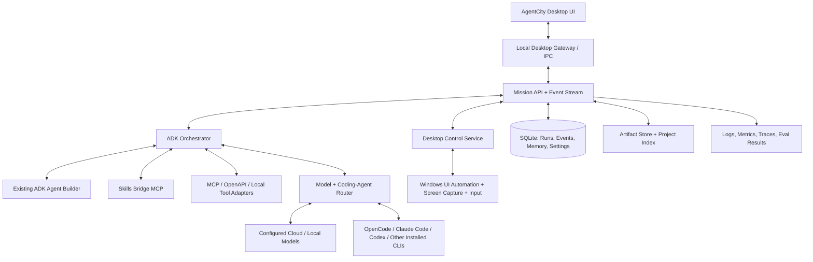

# AgentCity — Target Architecture

## 1. Architectural stance

Use one desktop shell, one source of truth for mission/run state, one primary orchestration brain for AgentCity-owned agent teams (Google ADK), and adapters for external coding agents, desktop-control drivers, model providers, and MCP servers.

The actual source repository must determine the first implementation step. If the workspace contains an existing application, map its components and extend it without replacing healthy functionality. If no suitable workspace exists, audit Personal Jarvis first as the likely foundation; choose another base only with an explicit comparison and recorded reason.

## 2. Logical system

This diagram expresses logical boundaries, not a mandate to add separate servers when the chosen foundation already supplies a suitable local API. Avoid unnecessary duplicative processes and frameworks.

## 3. Recommended stack (confirm after repository audit)

### Desktop shell
- Preferred when building an Electron-based extension: retain the base project's established secure Electron/React/Vite implementation instead of replacing it to chase a preference.
- If there is no usable shell, compare Tauri 2 and Electron against native desktop permissions, packaging complexity, voice/audio dependencies, computer-use libraries, existing reuse, and Windows installer reliability. Default to the most compatible proven shell rather than the lightest benchmark alone.
- UI: React + TypeScript; use the existing project's UI layer if healthy. Add a small design-token system, accessible components, route-level loading/error/empty states, and reusable charts/graphs.
- Keep `nodeIntegration` disabled; use context isolation and a narrow preload bridge for Electron. Validate every IPC schema.

### Agent and local API layer
- Python + Google ADK for AgentCity-owned agents and workflows.
- FastAPI or the existing backend API for the local mission gateway; structured request/response schemas and a streaming channel (WebSocket or SSE) for run events.
- Use the user's ADK Agent Builder tool to create/validate the intended agents where available; save the resulting definitions in source control and test the generated code/config.
- Consume Skills Bridge through its discovered MCP interface if it really is registered as MCP. Do not guess method names or invent a fake connection.
- Use the existing agent framework from the selected base through an adapter if needed. ADK remains the source of truth for mission planning/delegation unless architecture audit finds an evidenced limitation.

### State and storage
- SQLite by default, with explicit schema migrations and backups.
- Local artifact directory under an app-owned user-data folder, never the repository by default.
- SQLite FTS for initial retrieval; pluggable embeddings later if needed.
- OS credential manager for secrets (Windows Credential Manager/DPAPI-backed approach where appropriate); no secret values in SQLite/plain config/logging.
- No required database service or Docker.

### Validation and quality
- Python tests: pytest; static/type checks consistent with actual source.
- UI tests: Vitest/Testing Library or the base's existing suite.
- End-to-end: Playwright for app views/API, supplemented by platform-specific desktop smoke tests.
- ADK eval sets: explicit tool trajectories, final-response checks, safety cases, and mocked-provider tests. Evaluation findings should appear in AgentCity diagnostics.
- Use the current package manager/lockfile from the chosen base. Do not mix npm/pnpm/uv/pip tools needlessly.

## 4. ADK design

### Root orchestrator
`agentcity_root` accepts user intent plus explicit mode, project/workspace scope, available permissions, and budget. It selects a workflow and returns a typed mission plan before it starts side effects. It does not hold unrestricted OS access.

### Core ADK agents
- `planner`: decomposes task, marks dependencies, risk class, budget, and verification conditions.
- `researcher`: web/document retrieval, citations, evidence, and uncertainty.
- `architect`: solution design, existing-repo fit, interface contracts, and dependency review.
- `coder`: produces code changes only in assigned workspace/worktree.
- `debugger`: investigates failing tests or reproductions.
- `test_engineer`: adds and runs tests, records output.
- `reviewer`: reviews diffs, correctness, tests, and unintended scope.
- `security_guard`: evaluates permissions, prompt-injection signals, data egress, secrets, and risk policy.
- `desktop_operator`: calls the narrow desktop-control service; must not call OS APIs directly from the LLM loop.
- `verifier`: checks acceptance criteria and evidence before final mission completion.

Use ADK's supported agent composition and workflow patterns (sequential, parallel, loop, routing/dynamic workflows where applicable) rather than a custom orchestration engine unless proven necessary. Agent definitions need clear instructions, tool descriptions, typed outputs, failure modes, timeouts, and tests.

## 5. Skills Bridge and MCP

At startup/diagnostics:
1. Enumerate MCP server registrations and tools available in the actual environment.
2. Identify the user's custom Skills Bridge MCP by registered server metadata/description, not by invented names.
3. Read its actual schemas and documentation through the corresponding tool calls.
4. Implement a typed adapter preserving tool metadata, inputs, outputs, errors, and permission requirements.
5. Expose a capabilities catalog to ADK through the supported MCP integration.
6. Test disconnected server, invalid schema, timeout, malformed output, prompt-injection content, tool cancellation, and reconnection.

Do not blindly trust returned skill descriptions or web page contents. A skill is content to inspect; its declared actions still pass through AgentCity's permission policy.

## 6. Runtime adapters

### Model adapter
Represent provider as a capability profile (text, vision, audio-in, audio-out, tool use, context limit, streaming, structured output), auth status, latency, selected pricing metadata, and restrictions. Route by capability, user preference, quality record, budget, and availability. Keep a manual override. Never fabricate billing amounts; label estimates.

### Coding-agent adapter
Use only installed/authorized CLI/API integrations. Each task has explicit worktree path, branch, file ownership, time budget, and completion contract. Capture exit code, output references, changed-file list, test report, and actual commit SHA if created. A process that becomes idle is not proof of success.

### Desktop adapter
Prefer Windows UI Automation/accessibility controls. Use screen vision/OCR and mouse/keyboard only as fallback. Before acting, validate target window, action allowlist, visible screen age, and approval token if required. Use a failsafe key/hotkey and an emergency stop path outside the model loop.

### Voice adapter
Push-to-talk first. Define interfaces for microphone capture, streaming STT, optional wake-word detection, response TTS, barge-in/cancel, and audio-device errors. Use ADK's live/voice functionality where it fits the configured model and current APIs, with an adapter fallback. Expose mic-active and transmission status in the UI at all times.

## 7. Mission event contract

Define typed events with unique IDs, `mission_id`, `run_id`, optional `agent_id`, `task_id`, `sequence`, UTC timestamp, event type, visibility/risk metadata, and a schema-versioned payload.

Minimum event types:
- mission created/planned/approved/started/paused/resumed/cancelled/completed/failed
- task queued/started/progress/blocked/completed/failed/retried
- agent spawned/assigned/heartbeat/completed/failed/stopped
- tool requested/approval required/approved/rejected/started/succeeded/failed/timed out
- artifact created/updated
- budget warning/budget exceeded
- provider connected/disconnected/rate limited
- verification started/passed/failed

Events are persisted before the UI consumes them. Clients can reconnect and recover from a persisted sequence cursor. Do not treat ephemeral UI animation as backend state.

## 8. Lifecycle and recovery

- Persist mission plan and budgets before execution.
- Every action has a timeout and cancellation path.
- On crash/restart, mark interrupted steps; do not silently replay a potentially non-idempotent step.
- Resume only idempotent actions automatically. Reconfirm stale or external side effects.
- Separate agent heartbeat from success status. Define timeout, retry count, exponential backoff where appropriate, and dead-letter/error handling.
- Ensure cancellation propagates to ADK runs, child processes, MCP requests, and desktop loops.

## 9. Data model (minimum)

`projects`, `conversations`, `messages`, `agents`, `team_templates`, `missions`, `mission_tasks`, `agent_runs`, `events`, `tool_invocations`, `approval_requests`, `artifacts`, `provider_profiles`, `skill_registry`, `memory_entries`, `audit_events`, `routines`, `budget_events`, `evaluation_runs`, and `schema_migrations`.

Include created/updated timestamps, status fields, schema/version metadata, provenance, and redaction flags where appropriate. Store references to secret credentials, not credentials themselves.

## 10. Local network and IPC boundaries

- Bind API to loopback only by default, use an unpredictable per-launch capability token or secure IPC for desktop clients, and validate origin/CSRF boundaries.
- Never publish a port to the LAN unless the user explicitly enables remote access and configures authentication/TLS.
- Validate paths against user-approved roots; resolve symlinks; defend against path traversal and archive extraction attacks.
- Use structured process invocation without shell string concatenation. Restrict environment variable inheritance and redact environment output.
- Cap file size, screenshot size, queue size, tool output length, and memory growth.
