# System Diagrams

All diagrams are Mermaid and render on GitHub. They describe the target design;
areas marked planned are not implemented until the status matrix says so. Keep
node names stable when updating: they are referenced by ADRs and tests.

## 1. System context

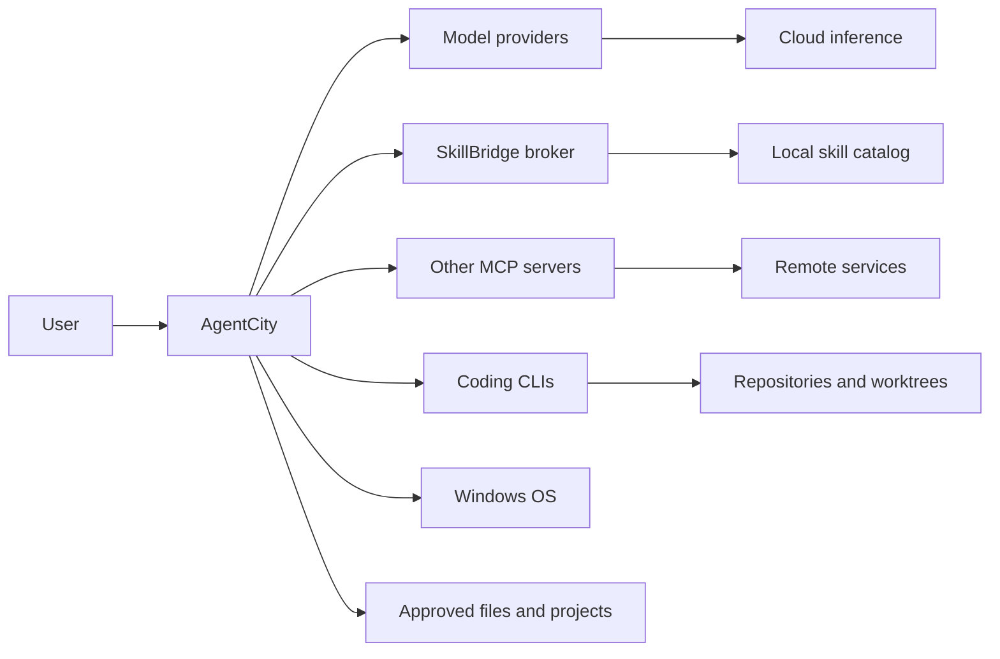

## 2. Containers

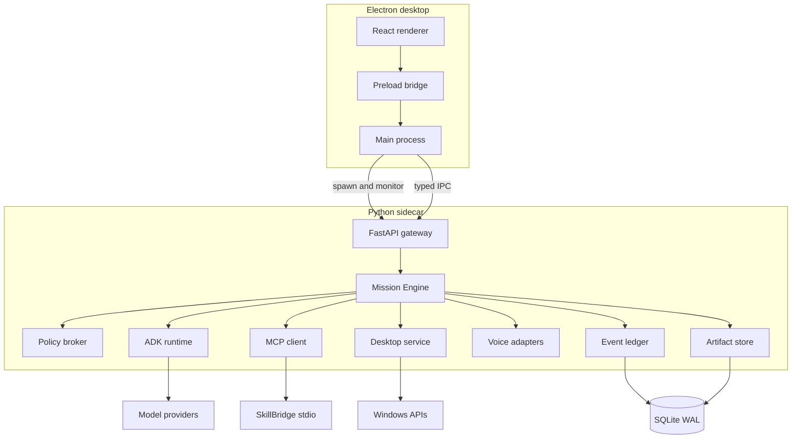

## 3. Backend components

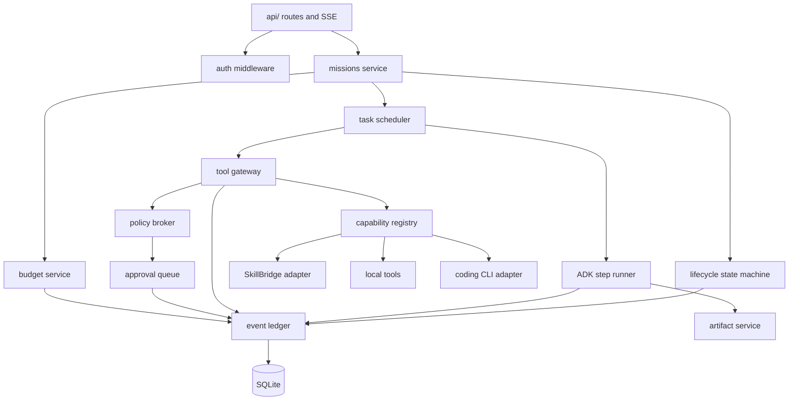

## 4. Mission lifecycle

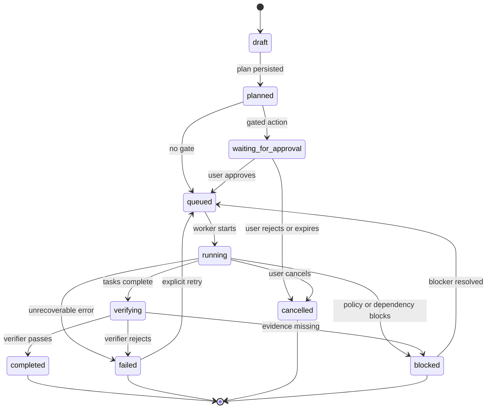

## 5. Mission execution sequence

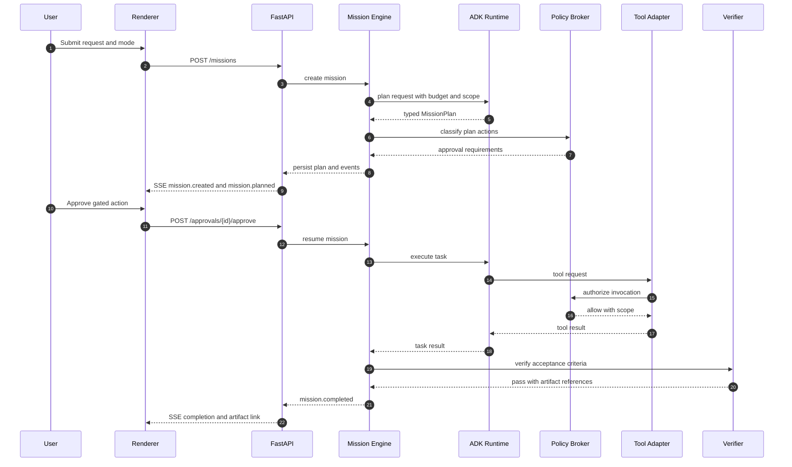

## 6. Approval and risk flow

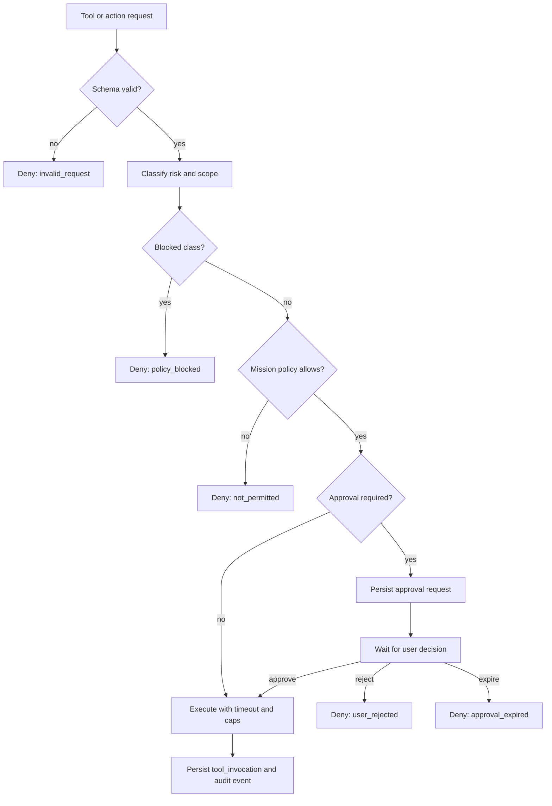

## 7. Data model

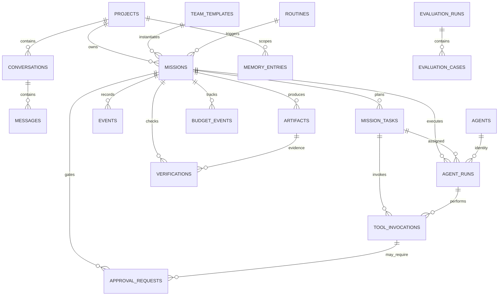

## 8. Trust boundaries and egress

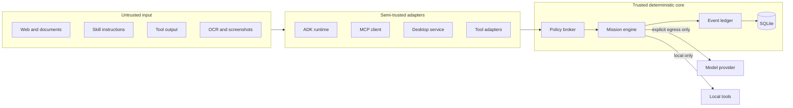

## 9. Startup and sidecar handshake

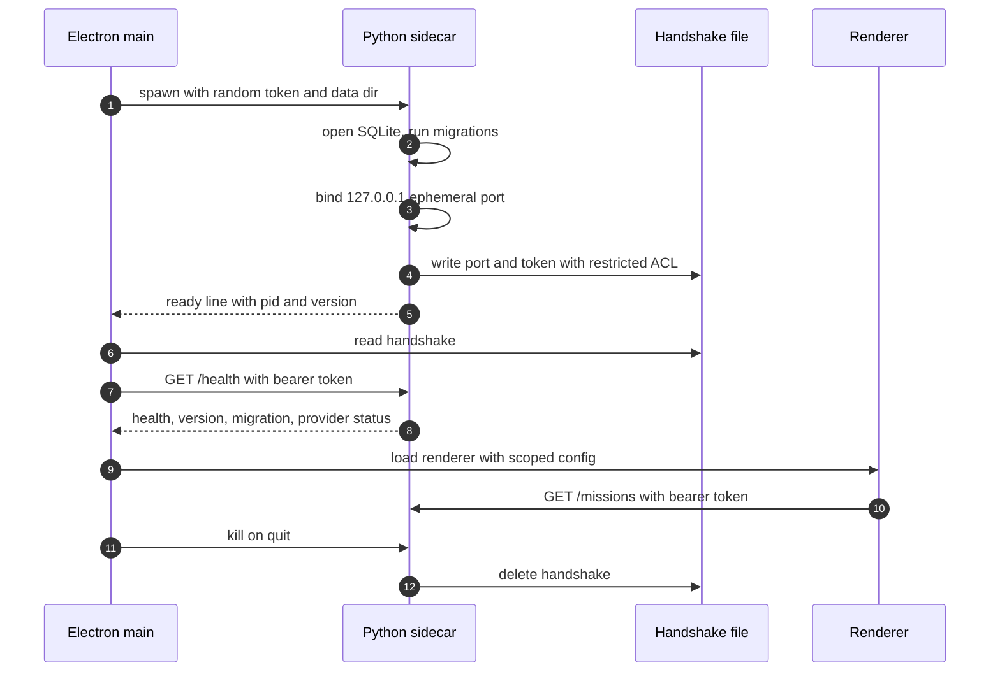

## 10. Event streaming and replay

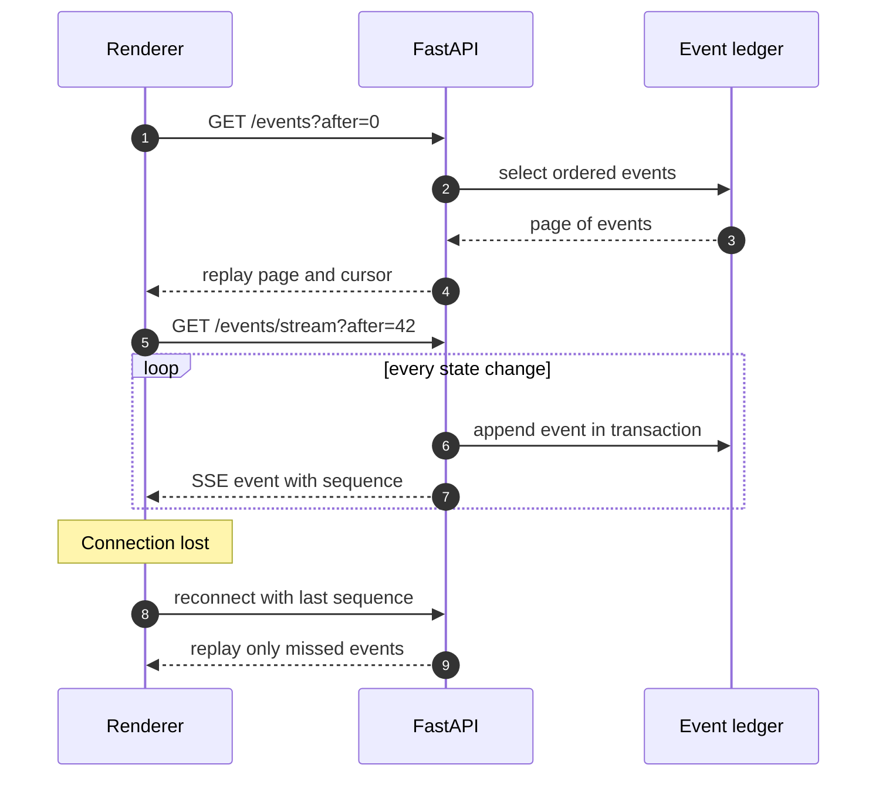

## 11. SkillBridge MCP integration

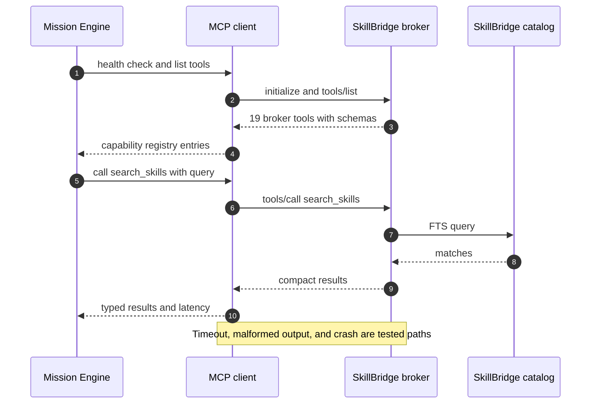

## 12. Desktop control

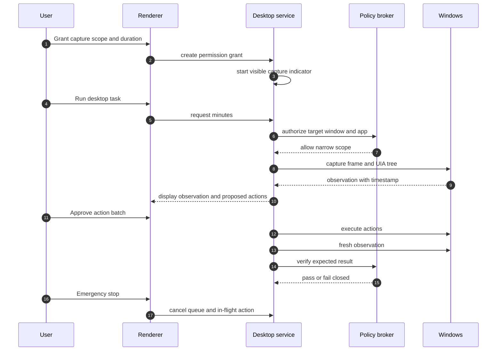

## 13. Voice pipeline

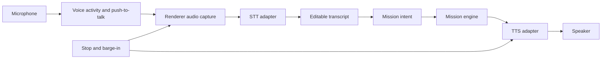

## 14. ADK agent topology

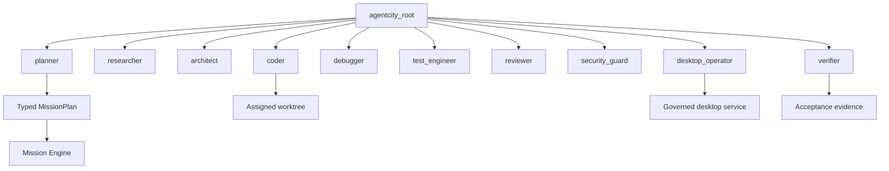

## 15. Packaging topology

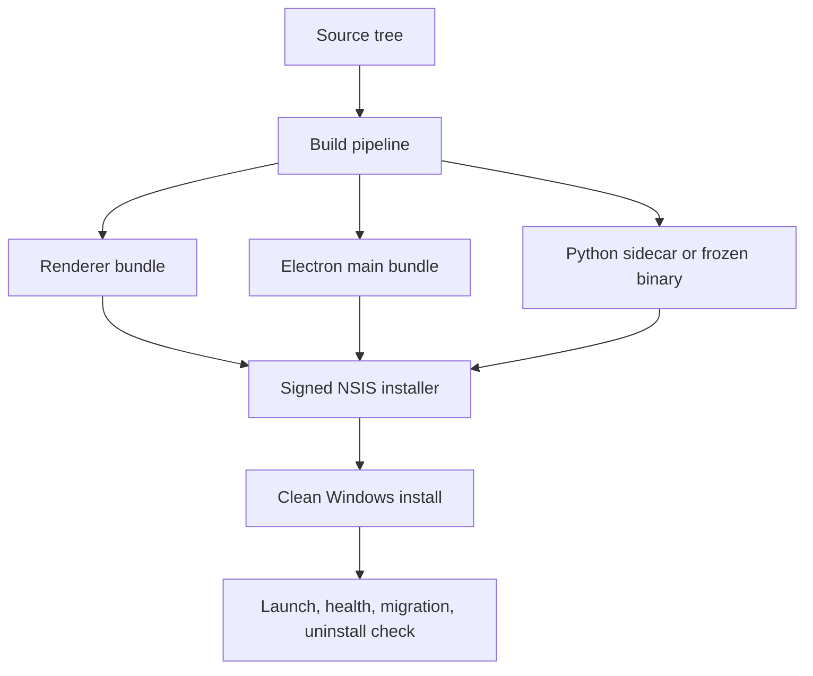

## 16. Development worktrees

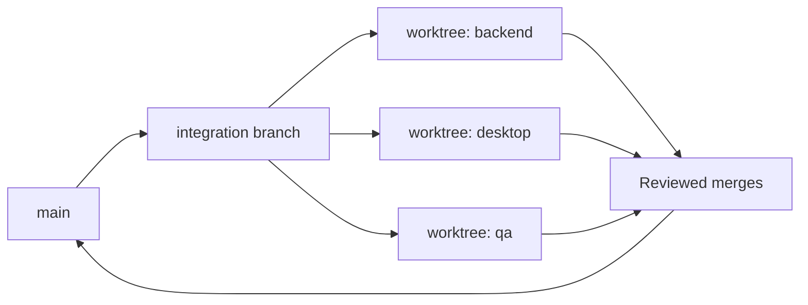
